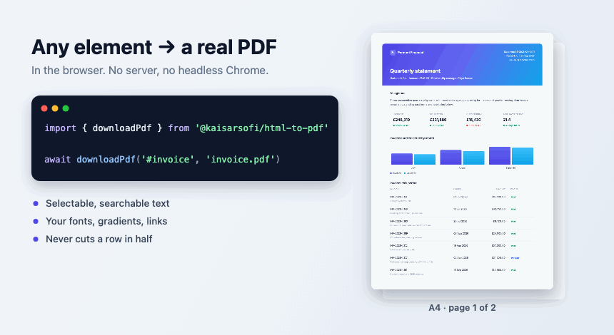
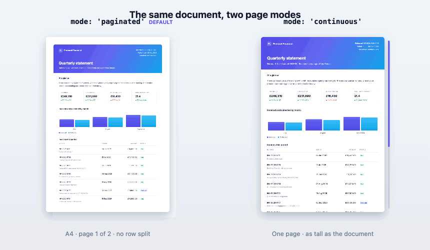

<div align="center">



<h1>@kaisarsofi/html-to-pdf</h1>

[](https://www.npmjs.com/package/@kaisarsofi/html-to-pdf)
[](https://www.npmjs.com/package/@kaisarsofi/html-to-pdf)
[](https://github.com/kaisarsofi/html-to-pdf/actions/workflows/ci.yml)
[](./LICENSE)

</div>

Turn any element already on your page into a real PDF, in the browser. It measures the layout
your browser has **already produced**, then draws it with `pdf-lib` — so the text stays
selectable and searchable, your fonts and gradients survive, and a page never ends halfway
through a table row. No headless Chrome, no server, no screenshots.

```ts
import { downloadPdf } from '@kaisarsofi/html-to-pdf';

await downloadPdf('#invoice', 'invoice.pdf');
```

That is the whole integration. Pass an element or a CSS selector; everything else is optional.

## Install

```sh
npm install @kaisarsofi/html-to-pdf
```

## Why not html2canvas or Puppeteer

|  | What goes wrong |
|---|---|
| **`html2canvas` + `jsPDF`** | Rasterises the element and slices it at fixed heights. The slice is blind, so it cuts through a line of text or a table row, and the output is a *picture* — unsearchable, and blurry when zoomed or printed. |
| **Puppeteer / `window.print()`** | Paginates with an algorithm you cannot inspect or steer, with [long](https://github.com/puppeteer/puppeteer/issues/6951)-[standing](https://github.com/puppeteer/puppeteer/issues/6366) layout bugs — and Puppeteer needs a headless browser to run and pay for. |

## Page modes

<div align="center">

</div>

```ts
await downloadPdf('#statement', 'statement.pdf');                      // A4 pages (default)
await downloadPdf('#statement', 'x.pdf', { page: { mode: 'continuous' } });  // one long page
```

Breaks are chosen from the measured geometry: a page ends where no line, row, image or card is
crossing it, and only closes when the next piece genuinely will not fit — so there is no
unexplained white space either. `'continuous'` makes a single page exactly as tall as the
document, for something only ever read on a screen.

## Works where you work

```tsx
// React, Next.js ('use client'), Vue — call it from an event handler
const ref = useRef<HTMLDivElement>(null);
<button onClick={() => downloadPdf(ref.current!, 'report.pdf')} data-pdf-hide>Download</button>
```

Nothing touches `document` at import time, so importing during SSR is safe — only the *call*
needs a browser. See [frameworks](./docs/frameworks.md).

## What survives the trip

Selectable text in your own fonts · backgrounds, gradients, borders and rounded corners ·
images and inline SVG · clickable `http` / `mailto:` / `tel:` links · `transform`, `clip-path`
and `box-shadow` · `₹` and friends without installing a font.

Anything that could only be approximated comes back in `notes`, and anything that changed the
output — a font that could not be embedded, an image the browser blocked — comes back in
`warnings`. It never throws at you:

```ts
const { bytes, pageCount, warnings, notes } = await generatePdf('#invoice');
```

## Documentation

| | |
|---|---|
| [Configuration](./docs/configuration.md) | Every option and its default |
| [Frameworks](./docs/frameworks.md) | React, Next.js (and `next/font`), Vue, plain HTML |
| [Fonts](./docs/fonts.md) | Why WOFF2 and variable fonts cannot be embedded |
| [Images](./docs/images.md) | The cross-origin problem, and both ways out |
| [How it works](./docs/how-it-works.md) | The four passes, and why there is no Node build |
| [Troubleshooting](./docs/troubleshooting.md) | Failure modes, in the order people hit them |

Run the examples with `npm run build && python3 scripts/serve.py`, then open
<http://localhost:4173/examples/>.

## Limits

Browser only — it measures a real layout, so there is no Node build. Inset shadows,
`clip-path: url()`, `calc()` / `var()` shapes, `backdrop-filter` and `::before` / `::after`
content are skipped; radial and conic gradients are approximated. ~840 kB packed, mostly the
bundled Inter and Noto Sans, both fetched lazily and only when a PDF needs them.

## License

[MIT](./LICENSE) © Kaisar Sofi. Bundled font licences in [`NOTICE`](./NOTICE).
