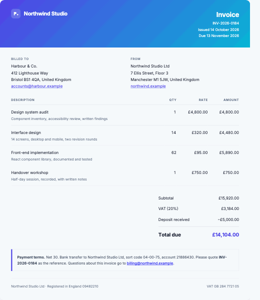
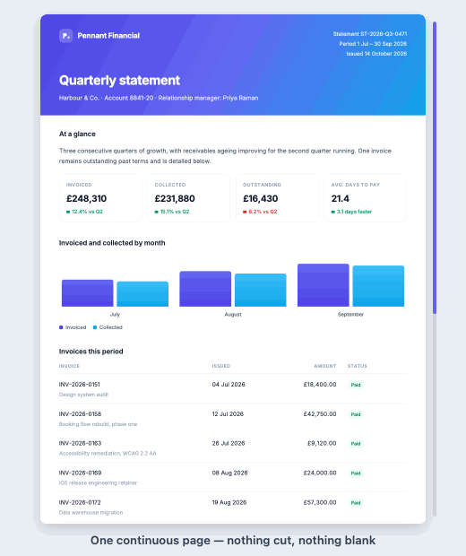
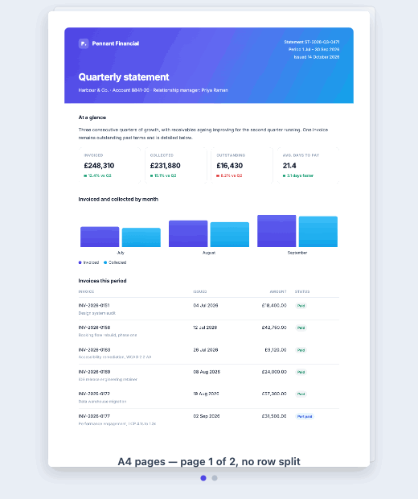

<div align="center">

# @kaisarsofi/html-to-pdf

**Turn any element on your page into a real PDF, in the browser, in one line.**
No headless browser, no server, no screenshots — just vector text, your fonts, and page breaks that land in sensible places.

[](https://www.npmjs.com/package/@kaisarsofi/html-to-pdf)
[](https://github.com/kaisarsofi/html-to-pdf/actions/workflows/ci.yml)
[](./LICENSE)
[](./dist/index.d.ts)



*Real output from [`examples/invoice.html`](./examples/invoice.html). Every frame is a fresh render of the PDF — the text stays sharp because it is text.*

</div>

---

## The problem

You want a PDF of something already on your page — an invoice, a report, a ticket. Today you
pick one of two bad options:

| | What goes wrong |
|---|---|
| **`html2canvas` + `jsPDF`** | Rasterises the element into one tall image and slices it at fixed heights. The slice is blind, so it cuts through a line of text or a table row. The output is a *picture*: you cannot select or search the text, and it blurs when zoomed or printed. |
| **Puppeteer / `window.print()`** | Paginates with an internal algorithm you cannot inspect or steer, with [long](https://github.com/puppeteer/puppeteer/issues/6951)-[standing](https://github.com/puppeteer/puppeteer/issues/6366) layout bugs. Puppeteer also means a headless browser process to run, host and pay for. |

This package does neither. It **measures the layout your browser already produced**, then
draws it as real PDF objects. Text stays text. Breaks land where nothing is crossing them.

## Install

```sh
npm install @kaisarsofi/html-to-pdf
```

## Use it

```ts
import { downloadPdf } from '@kaisarsofi/html-to-pdf';

await downloadPdf('#invoice', 'invoice.pdf');
```

That is the whole integration. No config, no fonts to host, nothing to wire up. Pass an
element or a CSS selector.

Need the bytes instead of a download?

```ts
import { generatePdf } from '@kaisarsofi/html-to-pdf';

const { bytes, pageCount, warnings } = await generatePdf(element);
```

## What you get

- **Selectable, searchable text** in the page's own fonts — embedded, not drawn as pixels
- **Backgrounds, gradients, borders, rounded corners** and rounded image crops
- **Images** (only resampled when far larger than shown) and **inline SVG** icons
- **Clickable links** — `http`, `mailto:`, `tel:`
- **CSS `transform`, `clip-path` and `box-shadow`**, drawn as vector shapes
- **`₹` and other symbols** without installing a font
- **One continuous page by default** — nothing cut, nothing left blank

## Two ways to page it

The same document, the same one-line call, two page modes.

<table>
<tr>
<td width="50%" align="center">

<br /><b>One long page</b> <i>(default)</i>
</td>
<td width="50%" align="center">

<br /><b>Normal A4 pages</b>
</td>
</tr>
<tr>
<td valign="top">

```ts
await downloadPdf('#statement', 'statement.pdf');
```

One page made exactly as tall as the document. Nothing
is cut and nothing is left blank, because there is no
break to get wrong — best for anything read on screen.

</td>
<td valign="top">

```ts
await downloadPdf('#statement', 'statement.pdf', {
  page: { mode: 'paginated', size: 'A4', margin: 30 },
});
```

Breaks are chosen from the measured geometry: a page
ends where no line, row, image or card is crossing it,
and only closes when the next piece will not fit.

</td>
</tr>
</table>

Both are real output from [`examples/statement.html`](./examples/statement.html).

## Sensible defaults

With no config at all:

| | Default |
|---|---|
| Layout | An exact copy of the screen (`layout: 'preserve'`) |
| Rendering | A hidden copy at **1440px** viewport width in the **light** theme, so the PDF never depends on the reader's window size or dark mode |
| Document width | Measured, held between 900 and 1200px — a phone still gets a desktop-width document |
| Pages | One continuous page |
| Fonts | The page's own static `@font-face` files; bundled Inter substituted when yours cannot be embedded |
| Missing characters | A bundled Noto Sans, loaded only if some character needs it |
| Images | Sharp at 2 device pixels per drawn pixel; smaller images untouched |
| Links | Clickable |

Hide what should not be in the PDF with `data-pdf-hide` (buttons, toolbars). Keep a block off
a break with `data-pdf-break="avoid"`.

## It never throws at you

A font that cannot be embedded, an image the browser will not let the page read, a CSS
feature that can only be approximated — none of these fail the export. You get the PDF plus
an honest account of what differs:

```ts
const { warnings, notes } = await generatePdf('#invoice');
```

## Documentation

| Guide | |
|---|---|
| [Configuration](./docs/configuration.md) | Every option, its default, and the markup hooks |
| [Frameworks](./docs/frameworks.md) | React, Next.js (including `next/font`), Vue, plain HTML |
| [Fonts](./docs/fonts.md) | Why WOFF2 and variable fonts cannot be embedded, and what to do |
| [Images](./docs/images.md) | The cross-origin problem, and both ways out |
| [How it works](./docs/how-it-works.md) | The four passes, and why there is no Node build |
| [Troubleshooting](./docs/troubleshooting.md) | The failure modes, in the order people hit them |

## Examples

Served over HTTP, because they use native ES modules:

```sh
npm run build && python3 scripts/serve.py
```

Then open <http://localhost:4173/examples/>. The [invoice](./examples/invoice.html) is the
one to look at first — it is the source of the GIFs above.

## Requirements and limits

- **Browser only.** It measures a real layout, so there is no Node build. Importing it
  during SSR is safe; calling it is not — call it from an event handler.
- **Not pixel-perfect for every CSS feature.** Inset shadows, `clip-path: url()` / `path()`,
  shapes using `calc()` / `var()`, `backdrop-filter` and `::before` / `::after` content are
  skipped; radial and conic gradients are approximated. All of it is reported in `notes`.
- **~1.6 MB packed**, mostly the bundled Inter and Noto Sans, which are fetched lazily at
  runtime only when a PDF actually needs them.

## Development

```sh
npm install
npm run build      # bundles the fonts, then compiles to dist/
npm test           # builds, then runs the suite
npm run typecheck  # no emit
```

TypeScript, strict mode.

## License

[MIT](./LICENSE) © Kaisar Sofi. Bundled font licences in [`NOTICE`](./NOTICE).
